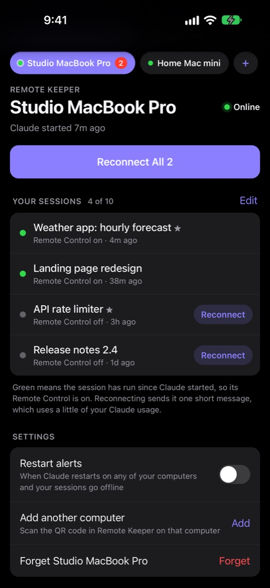
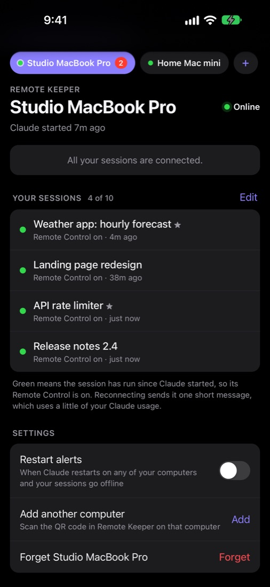
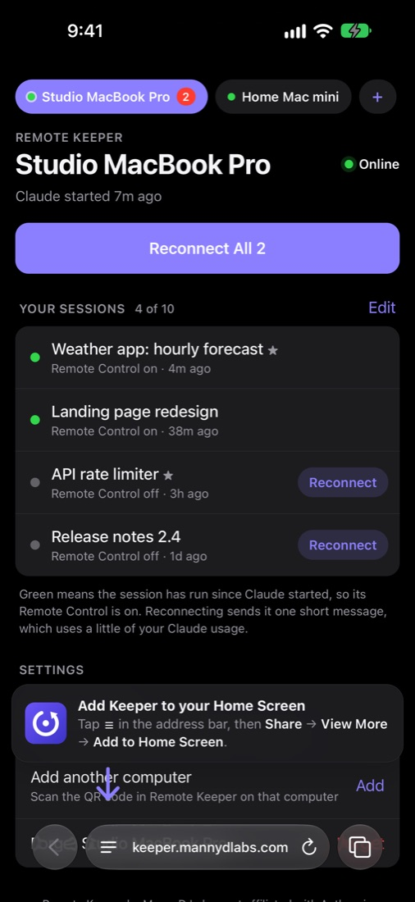
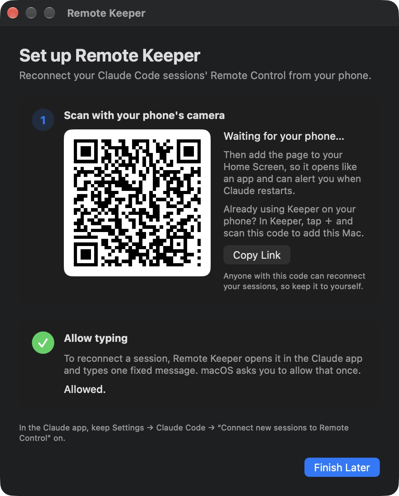
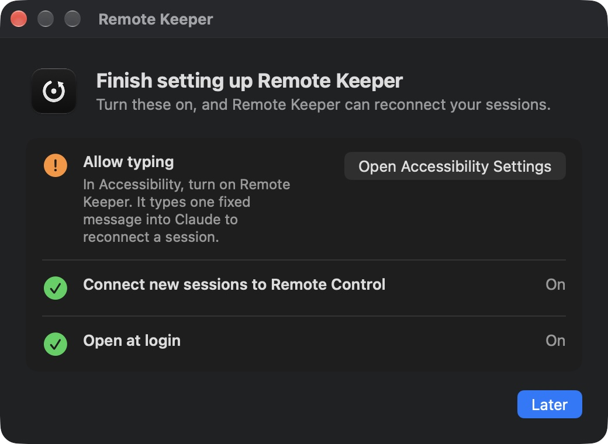

  

<h1 align="center">Remote Keeper for Claude Code</h1>

  <b>Keep your Claude Code sessions reachable from your phone.</b> 
  When the Claude desktop app restarts or updates, Remote Control switches off for every session. 
  Remote Keeper turns it back on from your phone, with one tap.

  
  &nbsp;
  
  &nbsp;
  

  <a href="#how-it-works">How it works</a> ·
  <a href="#install">Install</a> ·
  <a href="#privacy-and-security">Privacy and security</a> ·
  <a href="#faq">FAQ</a> ·
  <a href="https://github.com/mannyd209/remote-keeper/issues/new/choose">Report a bug / request a feature</a>

  
  &nbsp;
  
  &nbsp;
  

---

## Why I built it

Hi, I'm Manny from **MannyD Labs**. I run a lot of Claude Code sessions on my Mac and check on them from my phone with Remote Control. But every time the Claude app updated or restarted, Remote Control went off for every session, and I couldn't reach any of them until I was back at my desk. Remote Keeper fixes that.

## How it works

A Claude Code session turns Remote Control back on by itself as soon as it runs one turn. So when you tap **Reconnect** on your phone, Remote Keeper opens that session in the Claude app on your Mac (starting the app if needed) and sends it one fixed, short message: *"Remote Keeper: this message reconnects Remote Control for this session. Reply only: ok"*. A few seconds later the session is back on your phone.

- **Choose up to 10 sessions** per computer to keep connected. Remote Keeper only watches and reconnects those.
- **Restart alerts:** when Claude restarts and your sessions go offline, your phone gets a notification, and the app icon shows how many are offline.
- **Several computers:** link as many Macs as you like and switch between them in the app.
- **Nothing to install on your phone:** it's a web app you add to your Home Screen. It opens like an app and works on iPhone and Android.

## Install

1. **[Download Remote Keeper for Mac](https://github.com/mannyd209/remote-keeper/releases/latest/download/Remote-Keeper.dmg)**, open the DMG and drag **Remote Keeper** to **Applications**. Open it; it lives in your menu bar.
2. **Scan the QR code** it shows with your phone's camera.
3. **Add the page to your Home Screen.** A bouncing arrow points at the right button for your browser.
4. **Allow typing:** Remote Keeper shows a button that opens the exact spot in System Settings (Privacy & Security → Accessibility). It needs this to type its one message into the Claude app.
5. **Choose your sessions** in the app on your phone, and turn on **Restart alerts**.

To add another Mac, install Remote Keeper on it, then tap **＋** in the app on your phone and scan that Mac's code.

  
  &nbsp;
  

**Requirements:** macOS 13 or later and the Claude desktop app, with **Settings → Claude Code → Connect new sessions to Remote Control** turned on (Remote Keeper checks this and opens the right page if it's off). Your Mac has to be awake and unlocked to reconnect a session.

**Updates:** Remote Keeper checks this page's releases and offers **Update** in its menu. It only installs an update that's signed by MannyD Labs and notarized by Apple.

## Privacy and security

- **It only ever types one fixed message.** Nothing you type on your phone is sent to your computer, so Remote Keeper can't be used to run commands on it.
- **It only reconnects when you tap.** It never reconnects anything on its own.
- **It only reads** the Claude app's session list (titles, pinned, last activity) and its log, and never changes them.
- **End-to-end encrypted.** Your phone and your Mac talk through a small relay, but the QR code holds a secret in the part of the link that browsers never send to a server. Both ends derive their keys from it (HKDF-SHA256, AES-256-GCM), so the relay only passes along ciphertext: it can't read your session names or fake a tap. You can check this in [`web/crypto.js`](web/crypto.js) and [`mac/Relay.swift`](mac/Relay.swift).
- **No account and no tracking.** The relay keeps no session data, only push subscriptions for restart alerts.

Each reconnect is one short turn on that session's model, so it uses a little of your Claude usage.

## FAQ

**Windows?** Coming soon.

**Why does the Mac need to be unlocked?** Remote Keeper types into the Claude app the same way you would, and macOS doesn't allow typing into a locked screen.

**Can I build it myself?** Yes, the Mac app and the web app are here under the MIT license. Builds from source don't include our relay or its key (official releases are the only builds that can use it), so to run your own you need your own relay that speaks the same protocol: see [`docs/PROTOCOL.md`](docs/PROTOCOL.md), then set `REMOTE_KEEPER_HOST` and `REMOTE_KEEPER_APP_KEY`. Build with `mac/build.sh`.

## Support

Found a bug or have an idea? [Open an issue](https://github.com/mannyd209/remote-keeper/issues/new/choose). Questions: info@mannydlabs.com. If Remote Keeper saves you a trip back to your desk, you can [buy me a coffee](https://ko-fi.com/mannydlabs). ☕

---

Remote Keeper is an independent project by MannyD Labs. It is not affiliated with, endorsed by, or sponsored by Anthropic. Claude and Claude Code are trademarks of Anthropic. It relies on parts of the Claude app that aren't public APIs, so an app update can break it.
